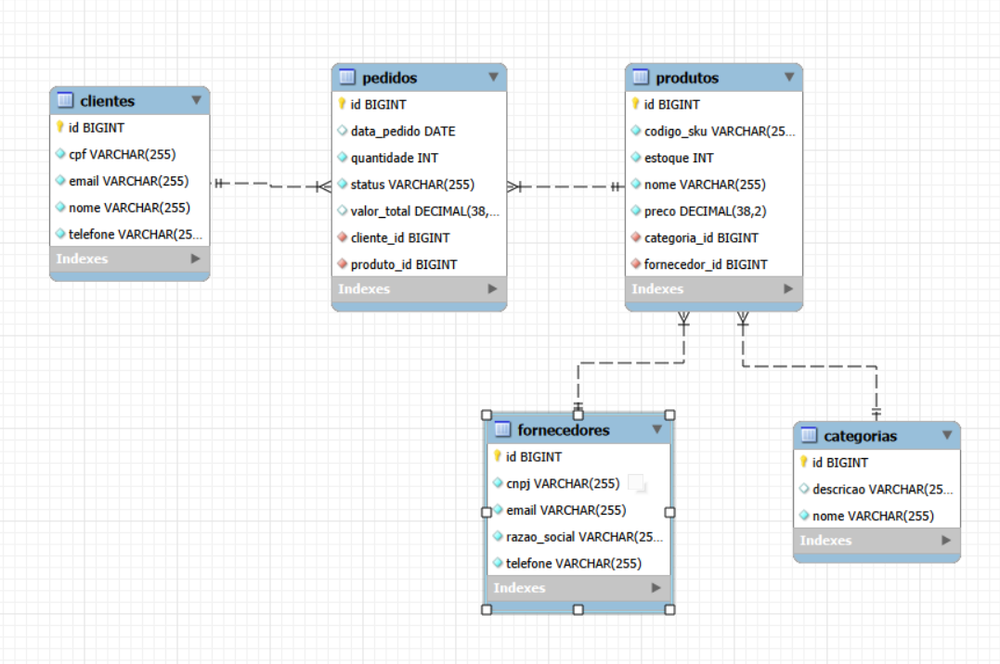

# TechStore MVC — Sistema de Gestão de Loja de Eletrônicos

Aplicação Web integrada a uma API REST desenvolvida na arquitetura **MVC (Model-View-Controller)** para digitalizar o controle de estoque, cadastro de clientes, fornecedores e registro de vendas de uma loja de eletrônicos.

## 1. Problema Atendido, Público Usuário e Funcionalidades

* **Problema atendido:** Elimina o controle manual feito em planilhas e anotações em papel, evitando divergências de saldo em estoque, duplicidade de cadastros (`CPF`, `CNPJ` e `SKU`) e falhas no cálculo de pedidos.

* **Público usuário:**
  * **Vendedores / Atendentes:** Consulta rápida de produtos e preços, cadastro de clientes e emissão de pedidos de venda.
  * **Gerentes / Estoquistas:** Cadastro de categorias, fornecedores, entrada de produtos e acompanhamento de status dos pedidos.

* **Principais funcionalidades:**
  * **CRUD completo** (Listar, Consultar por ID, Cadastrar, Atualizar e Excluir) para as 5 entidades do domínio: `Categorias`, `Fornecedores`, `Produtos`, `Clientes` e `Pedidos`.
  * **Validação de dados:** Verificação automática de campos obrigatórios, formato de e-mail e unicidade (`CPF`, `CNPJ`, `SKU`).
  * **Regra de negócio transacional:** Ao registrar um pedido, o sistema valida se há saldo suficiente em estoque, desconta automaticamente a quantidade vendida e calcula o `valorTotal` (`preço × quantidade`).
  * **Interface web responsiva:** Consumo assíncrono da API via `fetch`, exibindo estados de carregamento, sucesso, lista vazia e mensagens de erro sem exigir recarregamento manual da página.

## 2. Arquitetura do Programa (Padrão MVC)

A aplicação segue o padrão arquitetural **MVC (Model-View-Controller)** desacoplado, separando responsabilidades entre apresentação, controle de requisições HTTP, regras de negócio e persistência:

```text
+-------------------------------------------------------------------+
|                        CAMADA VIEW (Front-end)                    |
|   HTML5 + CSS3 + JavaScript (fetch API) — src/main/resources/static|
+---------------------------------+---------------------------------+
                                  | Requisições HTTP (JSON)
                                  v
+-------------------------------------------------------------------+
|                     CAMADA CONTROLLER (API REST)                  |
|  CategoriaController | FornecedorController | ProdutoController   |
|  ClienteController   | PedidoController     | GlobalExceptionHandler|
+---------------------------------+---------------------------------+
                                  | Aciona regras / persistência
                                  v
+-------------------------------------------------------------------+
|                  CAMADA SERVICE (Regras de Negócio)               |
|  PedidoService (@Transactional: valida estoque e calcula total)   |
+---------------------------------+---------------------------------+
                                  | Operações CRUD
                                  v
+-------------------------------------------------------------------+
|               CAMADA MODEL & REPOSITORY (Persistência)            |
|  Entidades JPA (entities) + Interfaces Spring Data (repository)   |
+---------------------------------+---------------------------------+
                                  | JDBC / Hibernate ORM
                                  v
+-------------------------------------------------------------------+
|                     BANCO DE DADOS (MySQL 8+)                     |
|                        Schema: techstore_db                       |
+-------------------------------------------------------------------+
```

### Estrutura de Diretórios

```text
API_TechStore/
├── Diagrama do banco.png            <-- Diagrama DER gerado no MySQL Workbench
├── src/
│   ├── main/
│   │   ├── java/
│   │   │   ├── techstore/dt2/techstore/
│   │   │   │   └── TechStoreApplication.java
│   │   │   ├── config/
│   │   │   │   └── GlobalExceptionHandler.java
│   │   │   ├── controller/          <-- Camada Controller (Endpoints REST)
│   │   │   ├── service/             <-- Camada Service (Regras de negócio)
│   │   │   ├── repository/          <-- Camada Repository (Spring Data JPA)
│   │   │   └── entities/            <-- Camada Model (Entidades JPA)
│   │   └── resources/
│   │       ├── application.properties
│   │       └── static/              <-- Camada View (index.html, style.css, app.js)
│   └── test/                        <-- Testes automatizados (JUnit 5 / Spring Boot Test)
├── .env.example
├── .gitignore
├── pom.xml
└── README.md
```

## 3. Tecnologias Utilizadas

* **Back-end:** Java 25, Spring Boot 4.0.0 (Spring Web, Spring Data JPA, Spring Validation)
* **Banco de Dados:** MySQL 8+ (Driver `mysql-connector-j`)
* **Front-end (View):** HTML5, CSS3 (Layout responsivo com Grid/Flexbox) e JavaScript ES6+ (`fetch API`)
* **Build e Dependências:** Apache Maven
* **Documentação e Testes:** Springdoc OpenAPI (Swagger UI), JUnit 5 e coleção Postman/HTTP

## 4. Modelo, Diagrama e Script do Banco de Dados (MySQL)

O banco de dados relacional `techstore_db` possui **5 tabelas** interligadas por chaves estrangeiras (`FK`), garantindo integridade referencial entre clientes, pedidos, produtos, categorias e fornecedores.

### Diagrama Entidade-Relacionamento (MySQL Workbench)

<p align="center">
  
</p>

### Script de Criação e Dados Iniciais (`schema.sql`)

```sql
CREATE DATABASE IF NOT EXISTS techstore_db
  CHARACTER SET utf8mb4
  COLLATE utf8mb4_unicode_ci;

USE techstore_db;

CREATE TABLE IF NOT EXISTS categorias (
    id BIGINT AUTO_INCREMENT PRIMARY KEY,
    nome VARCHAR(255) NOT NULL UNIQUE,
    descricao VARCHAR(255)
);

CREATE TABLE IF NOT EXISTS fornecedores (
    id BIGINT AUTO_INCREMENT PRIMARY KEY,
    razao_social VARCHAR(255) NOT NULL,
    cnpj VARCHAR(255) NOT NULL UNIQUE,
    telefone VARCHAR(255) NOT NULL,
    email VARCHAR(255) NOT NULL
);

CREATE TABLE IF NOT EXISTS produtos (
    id BIGINT AUTO_INCREMENT PRIMARY KEY,
    nome VARCHAR(255) NOT NULL,
    codigo_sku VARCHAR(255) NOT NULL UNIQUE,
    preco DECIMAL(38, 2) NOT NULL CHECK (preco >= 0),
    estoque INT NOT NULL CHECK (estoque >= 0),
    categoria_id BIGINT NOT NULL,
    fornecedor_id BIGINT NOT NULL,
    CONSTRAINT fk_produto_categoria FOREIGN KEY (categoria_id) REFERENCES categorias(id) ON DELETE RESTRICT,
    CONSTRAINT fk_produto_fornecedor FOREIGN KEY (fornecedor_id) REFERENCES fornecedores(id) ON DELETE RESTRICT
);

CREATE TABLE IF NOT EXISTS clientes (
    id BIGINT AUTO_INCREMENT PRIMARY KEY,
    nome VARCHAR(255) NOT NULL,
    cpf VARCHAR(255) NOT NULL UNIQUE,
    email VARCHAR(255) NOT NULL,
    telefone VARCHAR(255) NOT NULL
);

CREATE TABLE IF NOT EXISTS pedidos (
    id BIGINT AUTO_INCREMENT PRIMARY KEY,
    data_pedido DATE NOT NULL,
    status VARCHAR(255) NOT NULL DEFAULT 'CONFIRMADO',
    quantidade INT NOT NULL CHECK (quantidade >= 1),
    valor_total DECIMAL(38, 2) NOT NULL,
    cliente_id BIGINT NOT NULL,
    produto_id BIGINT NOT NULL,
    CONSTRAINT fk_pedido_cliente FOREIGN KEY (cliente_id) REFERENCES clientes(id) ON DELETE RESTRICT,
    CONSTRAINT fk_pedido_produto FOREIGN KEY (produto_id) REFERENCES produtos(id) ON DELETE RESTRICT
);

-- Carga inicial de dados para demonstração
INSERT INTO categorias (nome, descricao) VALUES
('Notebooks', 'Notebooks corporativos, ultrabooks e gamers'),
('Periféricos', 'Teclados mecânicos, mouses e headsets');

INSERT INTO fornecedores (razao_social, cnpj, telefone, email) VALUES
('Tech Distribuidora Nacional LTDA', '12.345.678/0001-99', '1133334444', 'contato@techdist.com.br');

INSERT INTO produtos (nome, codigo_sku, preco, estoque, categoria_id, fornecedor_id) VALUES
('Notebook Dell Inspiron 15', 'DELL-INS-15', 3899.90, 10, 1, 1);

INSERT INTO clientes (nome, cpf, email, telefone) VALUES
('Mariana Costa', '111.222.333-44', 'mariana.costa@email.com', '11988887777');
```

## 5. Pré-requisitos, Configuração e Execução Local

### Pré-requisitos

* **JDK 25** instalado e configurado no `JAVA_HOME`
* **Apache Maven 3.9+** (ou wrapper `./mvnw`)
* **MySQL Server 8.0+** em execução
* **Git**

### Variáveis de Ambiente (Sem segredos no código)

O arquivo `src/main/resources/application.properties` utiliza placeholders para proteger credenciais:

| Variável | Descrição | Valor Padrão |
| :--- | :--- | :--- |
| `SERVER_PORT` | Porta HTTP da aplicação | `8080` |
| `DB_HOST` | Host do servidor MySQL | `localhost` |
| `DB_PORT` | Porta do servidor MySQL | `3306` |
| `DB_NAME` | Nome do banco de dados | `techstore_db` |
| `DB_USER` | Usuário do MySQL | *(configurar no ambiente)* |
| `DB_PASS` | Senha do MySQL | *(configurar no ambiente)* |

### Passo a passo para instalar e executar

1. **Clone o repositório:**
   ```bash
   git clone https://github.com/Cotinguiba/API_TechStore.git
   cd API_TechStore
   ```

2. **Configure as variáveis de ambiente no terminal (ou na IDE):**
   ```bash
   export DB_USER=seu_usuario_mysql
   export DB_PASS=sua_senha_mysql
   ```

3. **Execute a aplicação:**
   ```bash
   mvn spring-boot:run
   ```

4. **Acesse no navegador:**
   * **Aplicação Web:** `http://localhost:8080`
   * **Swagger UI (Documentação OpenAPI):** `http://localhost:8080/swagger-ui.html`

## 6. Documentação dos Endpoints da API REST

* **URL Base:** `http://localhost:8080/api`
* **Content-Type:** `application/json`

### Resumo das Rotas

| Recurso | Métodos HTTP | Descrição | Códigos de Resposta |
| :--- | :--- | :--- | :--- |
| `/api/categorias` | `GET`, `GET/{id}`, `POST`, `PUT/{id}`, `DELETE/{id}` | Gerencia categorias de produtos | `200`, `201`, `204`, `400`, `404`, `500` |
| `/api/fornecedores` | `GET`, `GET/{id}`, `POST`, `PUT/{id}`, `DELETE/{id}` | Gerencia fornecedores | `200`, `201`, `204`, `400`, `404`, `500` |
| `/api/produtos` | `GET`, `GET/{id}`, `POST`, `PUT/{id}`, `DELETE/{id}` | Gerencia produtos e estoque | `200`, `201`, `204`, `400`, `404`, `500` |
| `/api/clientes` | `GET`, `GET/{id}`, `POST`, `PUT/{id}`, `DELETE/{id}` | Gerencia clientes | `200`, `201`, `204`, `400`, `404`, `500` |
| `/api/pedidos` | `GET`, `GET/{id}`, `POST`, `PUT/{id}`, `DELETE/{id}` | Registra vendas e abate estoque | `200`, `201`, `204`, `400`, `404`, `500` |

### Exemplos de Requisição e Resposta

#### 1. Cadastrar Produto (`POST /api/produtos`)

**Requisição:**
```json
{
  "nome": "Samsung Galaxy S24",
  "codigoSku": "SAM-S24-256",
  "preco": 4299.90,
  "estoque": 15,
  "categoria": { "id": 1 },
  "fornecedor": { "id": 1 }
}
```

**Resposta (`201 Created`):**
```json
{
  "id": 2,
  "nome": "Samsung Galaxy S24",
  "codigoSku": "SAM-S24-256",
  "preco": 4299.90,
  "estoque": 15,
  "categoria": { "id": 1, "nome": "Notebooks" },
  "fornecedor": { "id": 1, "razaoSocial": "Tech Distribuidora Nacional LTDA" }
}
```

#### 2. Registrar Pedido (`POST /api/pedidos`)

**Requisição:**
```json
{
  "cliente": { "id": 1 },
  "produto": { "id": 2 },
  "quantidade": 2,
  "status": "CONFIRMADO"
}
```

**Resposta (`201 Created`):**
```json
{
  "id": 1,
  "dataPedido": "2026-11-23",
  "status": "CONFIRMADO",
  "quantidade": 2,
  "valorTotal": 8599.80,
  "cliente": { "id": 1, "nome": "Mariana Costa" },
  "produto": { "id": 2, "nome": "Samsung Galaxy S24", "estoque": 13 }
}
```

#### 3. Exemplo de Erro de Validação / Regra de Negócio (`400 Bad Request`)

```json
{
  "erro": "Estoque insuficiente. Disponível: 13",
  "status": 400,
  "timestamp": "2026-11-23T21:15:00"
}
```

## 7. Testes e Evidências de Execução

### Como executar os testes

* **Testes Automatizados (JUnit 5):**
  ```bash
  mvn test
  ```

* **Testes Manuais / Coleção de Requisições:**
  Acesse `http://localhost:8080/swagger-ui.html` para testar interativamente ou importe os exemplos da Seção 6 no **Postman/Insomnia**.

### Resultados Obtidos nos Cenários Validados

| Caso de Teste | Endpoint | Cenário Testado | Status Esperado | Status Obtido | Resultado |
| :--- | :--- | :--- | :---: | :---: | :---: |
| **CT01** | `POST /api/categorias` | Cadastro de categoria válida | `201 Created` | `201 Created` | Aprovado |
| **CT02** | `POST /api/fornecedores` | Cadastro de fornecedor com CNPJ único | `201 Created` | `201 Created` | Aprovado |
| **CT03** | `POST /api/produtos` | Cadastro de produto vinculado a categoria e fornecedor | `201 Created` | `201 Created` | Aprovado |
| **CT04** | `POST /api/clientes` | Cadastro de cliente com CPF único | `201 Created` | `201 Created` | Aprovado |
| **CT05** | `POST /api/pedidos` | Criação de pedido com baixa automática no estoque | `201 Created` | `201 Created` | Aprovado |
| **CT06** | `POST /api/pedidos` | Tentativa de venda acima do estoque disponível | `400 Bad Request` | `400 Bad Request` | Aprovado |
| **CT07** | `GET /api/produtos/999` | Consulta de identificador inexistente | `404 Not Found` | `404 Not Found` | Aprovado |
| **CT08** | `POST /api/clientes` | Tentativa de cadastro com CPF duplicado | `400 Bad Request` | `400 Bad Request` | Aprovado |

## 8. Fluxo da Solução (Interface ↔ API ↔ Banco de Dados)

1. **Interação na View (`app.js`):** O usuário preenche o formulário na interface web e aciona o envio. O JavaScript serializa os campos em JSON e dispara uma requisição assíncrona via `fetch`.
2. **Recepção e Validação no Controller:** O controlador REST correspondente recebe o payload, valida as restrições de entrada (`@Valid`) e delega o processamento.
3. **Regra de Negócio no Service (`PedidoService`):** Para vendas, a camada de serviço executa uma transação atômica (`@Transactional`) que verifica o saldo no banco, atualiza o estoque do produto e calcula o valor final do pedido.
4. **Persistência via Repository (Spring Data JPA):** As alterações são traduzidas pelo Hibernate para comandos SQL executados no **MySQL** (`techstore_db`).
5. **Atualização Reativa na Interface:** A API retorna o status HTTP e o JSON resultante; a página exibe o feedback visual (sucesso ou erro) e atualiza a tabela de listagem automaticamente sem recarregar o navegador.

## 9. Créditos e Recursos Externos

* **Spring Boot & Spring Data JPA** — Pivotal / VMware (Licença Apache 2.0)
* **Hibernate ORM & Jakarta Bean Validation** — Eclipse Foundation (Licença Apache 2.0)
* **MySQL Connector/J & MySQL Workbench** — Oracle Corporation (Licença GPLv2)
* **Springdoc OpenAPI UI** — Documentação Swagger automatizada (Licença Apache 2.0)
